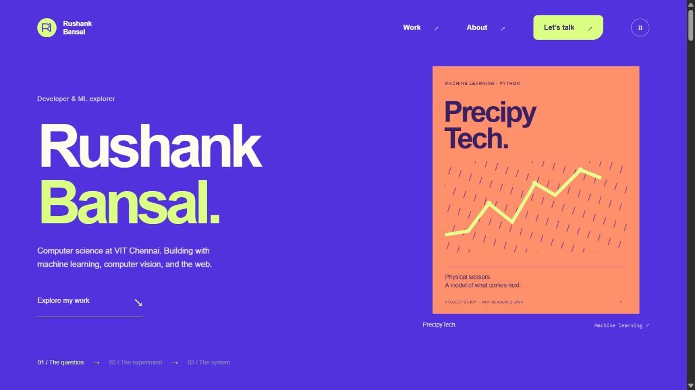

# Rushank Bansal · Personal Portfolio

An interactive portfolio showcasing my work in machine learning, computer vision, developer tools, and web development. Built with an editorial scroll story and a private content editor, so projects and profile details can be updated directly through the website.

## Live website

**[rushank-bansal-portfolio.vercel.app](https://rushank-bansal-portfolio.vercel.app/)**

[View the portfolio](https://rushank-bansal-portfolio.vercel.app/) · [Owner editor](https://rushank-bansal-portfolio.vercel.app/admin) · [Résumé](https://rushank-bansal-portfolio.vercel.app/resume.pdf)



## About

I’m a Computer Science and Engineering student at **VIT Chennai**, with expected graduation in **2029**. I learn by building complete projects, from preparing data and training models to connecting them to interfaces and backends.

This repository contains the **portfolio website and its editor**. The projects described below are featured work; their individual application source code is not bundled here.

## Features

- **Scroll storytelling:** a three-chapter introduction that connects questions, experiments, and working systems with project-specific artwork.
- **Project gallery:** category filters and detailed project stories with contributions, technologies, and optional live/source links.
- **Private owner editor:** add, edit, remove, and reorder projects, experience, skills, and certifications; update profile, education, contact details, and scroll-story copy.
- **Uploads:** project images and résumé PDFs, with file-type validation and a 4 MB limit in the editor.
- **Persistent online content:** saved edits and uploads survive Vercel function restarts and redeployments.
- **Owner authentication:** hashed passwords, expiring HttpOnly sessions, login rate limits, and password changes that revoke existing sessions.
- **Content backups:** export and import portfolio content through the editor.
- **Accessible interaction:** keyboard navigation, labeled forms, project dialogs, and reduced-motion support.
- **Responsive layouts:** layouts adapt to desktop, tablet, and mobile screens.

The artwork is labeled as project studies or conceptual illustration, rather than screenshots or measured results.

## Featured work

| Project | What it explores | Technologies |
| --- | --- | --- |
| **PrecipyTech** | Rainfall prediction from physical sensor readings | Python, scikit-learn, pandas, NumPy |
| **Fact-Checker** | A Chrome extension connected to a custom-trained classification model | Python, JavaScript |
| **DevPilot** | An AI-assisted coding tool built in a two-person team | JavaScript, NVIDIA AI API |
| **Gesture Recognition** | Live hand-gesture classification from webcam landmarks | Python, MediaPipe, scikit-learn |
| **Gym Management** | A website for storing and managing gym membership information | HTML, CSS, JavaScript, MySQL |
| **Backend REST API** | A backend serving a web application | Node.js, Express |

Fact-Checker predictions are probabilistic and require source verification.

## Technology

| Area | Implementation |
| --- | --- |
| Frontend | HTML, CSS, browser JavaScript modules |
| Animation | CSS transforms and a scroll controller using requestAnimationFrame |
| Local server | Node.js HTTP server |
| Hosted backend | Node.js 22 Vercel Function |
| Online storage | Private Vercel Blob store, through @vercel/blob |
| Local storage | JSON files in a private .data/ directory |
| Tests | Node.js built-in test runner |

There is no frontend framework or build step. Browser assets have no external script, font, analytics, or image-generation dependency.

## Run locally

Use **Node.js 22** and npm.

```bash
git clone https://github.com/rushankbansal-spec/Portfolio.git
cd Portfolio
npm ci
npm start
```

Open **http://localhost:5173**. This is the local development address; the public website is the Vercel link above.

On the first local launch, the server prints a **private setup link**. Open it to choose an owner password of at least 12 characters. After setup, sign in at `/admin`.

The local editor and hosted editor have separate data and accounts. Local files are never used as the production database.

## Update content without code

1. Sign in through **Owner access** in the website footer, or visit `/admin`.
2. Select the section you want to update.
3. Edit the content, upload images or a résumé, and reorder items as needed.
4. Choose **Save changes** or press **Ctrl/Cmd+S**.
5. Refresh the public portfolio to see the update.

The **Profile** section controls the opening introduction. **Scroll story** controls the following two chapters. **Account & backup** contains password changes and content export/import.

Online content changes do not require editing GitHub files or redeploying. A JSON content export includes links to uploaded media; retain those files or the corresponding storage backup as well.

## Vercel deployment

The site is deployed at **[rushank-bansal-portfolio.vercel.app](https://rushank-bansal-portfolio.vercel.app/)**.

`vercel.json` configures static assets from `public/`, the `/admin` route, API rewrites, and security headers. `api/handler.mjs` connects the hosted API to private Blob storage.

For a separate deployment:

1. Import this repository into a Vercel project. Use Node.js 22, framework **Other**, output directory **public**, and `npm ci` as the install command. No build command is needed.
2. Create a **private Vercel Blob store** and connect it to the project.
3. Configure the environment variables below through Vercel's project settings.
4. Deploy, then complete one-time owner setup using your private setup token in the `/admin#setup=...` link.

| Variable | Purpose |
| --- | --- |
| `BLOB_READ_WRITE_TOKEN` | Server-side access to the connected private Blob store. Vercel provisions this when connecting storage. |
| `PORTFOLIO_SETUP_TOKEN` | A cryptographically random secret of at least 32 characters for one-time owner setup. Configure it as a sensitive production variable. |

Never commit either value or a completed setup link. The existing live deployment already has its storage and environment configured.

Content, hashed credentials, sessions, and rate-limit records are stored privately. Public media requests can retrieve only opaque uploaded-file names, not the state file. Storage updates use conditional writes to avoid losing simultaneous changes. The content seed is used only before saved online content exists; redeployments do not reset it.

Uploading source to this repository does not itself change the live deployment. Git-based automatic deployment can be configured separately in Vercel.

## Tests

```bash
npm test
```

The 11 checks cover authentication, private setup, cross-origin protection, password changes, saved content, upload validation and limits, media access, separate hosted function instances, and concurrent storage updates. Hosted storage tests use a simulated Blob backend; deployment smoke checks verified the real public site, editor routes, résumé, setup protection, and private-state route.

## Project structure

```text
api/handler.mjs              Vercel entry point
lib/hosted-api.mjs           Hosted editor, authentication, and media routes
lib/blob-store.mjs           Private Blob storage and conditional writes
public/                     Portfolio, editor, artwork, and résumé
scripts/                    Deployment packaging helpers
tests/                      Local and hosted-backend tests
docs/preview.png            Portfolio preview
content.seed.json           Initial public portfolio content
server.mjs                  Local server and shared content validation
vercel.json                 Vercel routes and security headers
```

`.data/`, `.vercel/`, `.env*`, `node_modules/`, and uploaded local media are excluded from version control. Owner passwords, session data, storage credentials, and private setup tokens are not part of this repository.

## Connect

[GitHub](https://github.com/rushankbansal-spec) · [LinkedIn](https://www.linkedin.com/in/rushank-bansal-306035374/) · [Email](mailto:rushankbansal@gmail.com)
